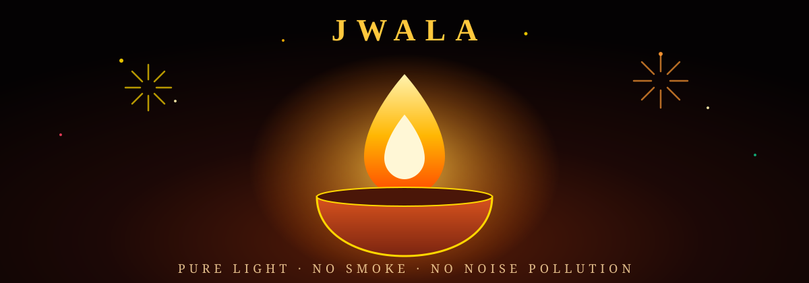

<div align="center">



# Jwala — Pure Light Diwali

### An interactive festival courtyard and virtual pooja diya celebrating Deepavali with light and sound alone. Zero smoke. Zero particulate pollution. Zero residue.

[](https://razeltech.github.io/diwali/)
[](https://r2dapps.github.io/diwali/)


**Designed for full-screen display in a darkened room with ambient sound enabled.**

</div>

---

## Overview

Jwala (ज्वाला) represents the sacred flame. Deepavali marks the timeless celebration of illumination overcoming obscurity. Jwala delivers the visceral ambiance, kinetic energy, and acoustic richness of a classic Diwali courtyard directly within modern web browsers.

Every flame, spark, ballistic trail, and concussive sound wave is synthesized live using HTML5 Canvas physics and the Web Audio API. No external image sprites, media files, or server runtimes are loaded.

---

## Interactive Courtyard Arsenal

The interactive arsenal provides authentic representations of traditional Indian festive fireworks and lamps. Select any instrument from the bottom dock, position it in the courtyard, and bring the phuljhari sparkler to the fuse to initiate ignition.

| Instrument | Class | Mechanics & Visual Character |
|---|---|---|
| **Phuljhari** | Ignitor / Sparkler | Handheld sparkler emitting continuous micro-sparks with dynamic light propagation. Acts as the primary lighting torch for all fuses. |
| **Mitti Diya** | Traditional Lamp | Terracotta oil lamp with realistic fluid flame convection, teardrop combustion core, and ambient courtyard warmth. |
| **Chakri** | Ground Spinner | High-rpm ground-spinning disc generating tangential centrifugal spark spirals and ground scorch glow. |
| **Anaar** | Spark Fountain | Conical earthenware fountain erupting vertical cascades of golden and polychromatic incandescent embers. |
| **Sutli Bomb** | Concussive Charge | High-amplitude acoustic shockwave accompanied by physical screen shake, bright flash, and reverberant courtyard decay. |
| **Rocket** | Ballistic Aerial | Accelerating propellant ascent with smoke trail lighting, detonating at peak altitude into algorithmic sky breaks. |
| **100 Wala** | Linear Garland | Sequential linear cracker chain with precise staccato cadence (*tak-tak-tak-tak*) and rapid directional combustion. |
| **1000 Wala** | High-Speed Garland | Extended straight cracker strand delivering a continuous machine-gun acoustic rhythm and dense spark trail. |
| **5000 Wala** | Spiral Barrage | Coiled cylindrical roll combusting along an inward spiral path, building into a dense acoustic roar. |
| **10,000 Wala** | Grand Finale Ladi | Massive coiled ceremonial roll with sustained rhythmic thunder, concluding with an explosive bomb head. |
| **12 / 30 / 60 Shots** | Aerial Batteries | Automated multi-tube repeaters launching timed vertical volleys, lateral fan sweeps, and multi-break grand finales. |

---

## Sky Break Formations

Rockets and aerial battery shells randomly select from 13 distinct procedural pyrotechnic break patterns:

- **Navratna Crackle**: Multi-hued gemstone spheres transitioning into loud micro-burst crackling clouds.
- **Heart**: Symmetrical cardiac contour composed of crimson and rose incandescent embers.
- **Satrangi Rings**: Concentric seven-color orbital rings expanding outward in synchronized harmony.
- **Crossette**: Primary shells that fracture into four symmetrical darts, subdividing repeatedly.
- **Golden Willow**: Long-burning golden charcoal streamers weeping toward the ground in heavy arcs.
- **Ganga-Jamuna**: Dual-tone cascading rivers of saffron and azure stars.
- **Kundan Palm**: Thick rising palm trunks opening into heavy metallic gold tendrils with coconut crackle tips.
- **Double Break**: Timed two-stage detonation creating an inner pastel sphere enclosed by an expansive outer ring.
- **Diwali Chakra**: Rotating aerial burst emitting directional spark spokes along a circular perimeter.
- **Saturn Ring**: Spherical planetary core surrounded by an angled elliptical particle ring.
- **Spider Comets**: Fast-traveling, thick golden streamers tracing long radial tentacles across the sky.
- **Silver Glitter**: Bright white magnesium strobe sparkles that hang suspended before gradual dissipation.
- **Chit-Chit Storm**: Dense acoustic barrage of rapid-fire micro-sparklers bursting in rapid succession.

---

## Dual Celebration Modes

### 1. Courtyard Mode
The complete interactive festive environment. Place multiple diyas, ignite spinning chakris, arrange cascading anaars, or orchestrate sky-filling fireworks displays with full spatial particle physics and lighting.

### 2. Pooja Diya Mode
A minimalist, meditative mode centering on a large ceremonial brass lamp. Strips away all cracker controls to provide a serene, contemplative flame simulation with natural flicker acoustics and room illumination. Ideal for pooja displays, ambient monitors, and devotional backgrounds.

---

## Operating Instructions

1. **Selection**: Click or tap an instrument from the bottom brass navigation bar. Scroll or drag horizontally across the dock to view the full collection.
2. **Placement**: Click or tap anywhere across the courtyard ground to position the selected instrument.
3. **Ignition**: Select the Phuljhari tool or drag the sparkler near the instrument's fuse until ignition occurs.
4. **Sound Control**: Toggle synthesized audio via the top-right speaker control.
5. **Courtyard Reset**: Clear active ground instruments using the circular reset button. In Pooja mode, this extinguishes the lamp for re-lighting.
6. **Dark-Room Optimization**: Display controls automatically fade into transparency when idle to preserve room immersion. Move the cursor or touch the display to restore controls.

---

## Technical Architecture

```
e-diwali/
├── index.html        # Unified application runtime (Canvas, Web Audio, UI)
├── banner.svg        # Vector showcase banner for repository and previews
├── robots.txt        # Search engine crawler instructions
├── sitemap.xml       # Canonical XML sitemap for SEO discovery
├── .nojekyll         # GitHub Pages Jekyll bypass flag
├── README.md         # Primary documentation (Razeltech)
└── README.r2dapps.md # Mirror documentation (R2D Apps)
```

- **Canvas Rendering Engine**: Custom 60 FPS particle simulator handling gravity vectors, drag coefficients, spark lifetimes, smoke-free glow diffusion, and additive compositing (`globalCompositeOperation = 'lighter'`).
- **Procedural Web Audio API**: Complete sound synthesis pipeline without sampled audio clips:
  - Fuse burn: Pink noise passed through a dynamic bandpass filter with frequency jitter.
  - Explosions & Bombs: Low-frequency sine sweeps blended with shaped white noise bursts, routed through biquad lowpass filters and subtle waveshaper saturation.
  - Ladi firecrackers: High-Q bandpass filtered noise bursts modulated with rapid logarithmic gain envelopes.
  - Rocket motors: Resonant low-pass sweeps with pitch modulation matching ballistic climb velocity.
- **Zero External Runtime Dependencies**: Single self-contained HTML page loading Tailwind CSS and Google Fonts via CDN.
- **Screen Wake Lock**: Incorporates the Screen Wake Lock API to prevent mobile and desktop displays from dimming or sleeping during celebrations.

---

## Repositories & Live Deployments

This project is maintained across dual synchronized repositories:

| Instance | Repository | Live Deployment |
|---|---|---|
| **Primary** | [github.com/razeltech/diwali](https://github.com/razeltech/diwali) | [razeltech.github.io/diwali](https://razeltech.github.io/diwali/) |
| **Mirror** | [github.com/r2dapps/diwali](https://github.com/r2dapps/diwali) | [r2dapps.github.io/diwali](https://r2dapps.github.io/diwali/) |

---

## Local Execution & Deployment

### Local Execution
Double-click `index.html` to run in any modern desktop browser (Chrome, Firefox, Safari, Edge). An active internet connection is only required on the first launch to load web fonts. Web Audio initializes immediately upon the first user interaction in adherence to browser autoplay policies.

### GitHub Pages Deployment
1. Navigate to repository **Settings -> Pages**.
2. Under **Build and deployment**, set **Source** to `Deploy from a branch`.
3. Select branch `main` and path `/ (root)`.
4. Save. GitHub Pages will build and publish the live site within sixty seconds.

---

## License

Open source under the [MIT License](https://opensource.org/licenses/MIT).
